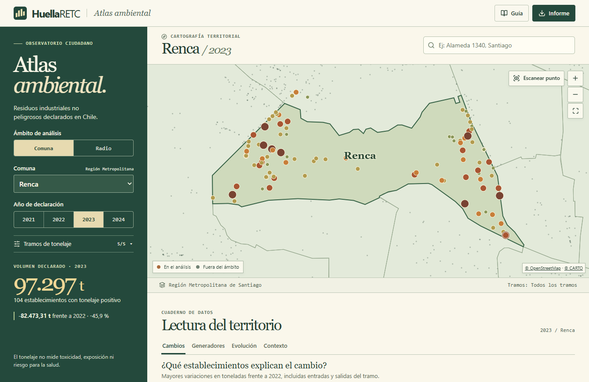

# 🌍 HuellaRETC: Monitor Ambiental Ciudadano


> **Democratizando el acceso a la información ambiental.**
> Explora generadores industriales, compara periodos y prepara reportes con datos de residuos no peligrosos del SINADER/RETC.

**[Inicio rápido](#inicio-rapido) · [Funcionalidades](#funcionalidades) · [Datos](#datos) · [Despliegue](#despliegue)**

> Los tonelajes describen residuos declarados: por sí solos no miden exposición, peligrosidad ni riesgo para la salud.

### Un mapa, un análisis

**Explorar** es la vista inicial: desplázate y acerca el mapa sin seleccionar un territorio. Puedes consultar fichas y comparar visualmente los establecimientos de distintas comunas con el mismo año y tramo. Buscar una dirección centra el mapa sin cambiar de modo. Los totales, la comparación interanual y los informes se habilitan al delimitar una **Comuna** o un **Radio**.

Elige **Comuna** para estudiar una de las 52 comunas de la Región Metropolitana o **Radio** para analizar 1, 3 o 5 km en cualquier punto de Chile. Usa el buscador de direcciones o **Escanear punto** para mover el centro. El año y los tramos de tonelaje se mantienen al cambiar de ámbito. Los puntos grises son contexto y no entran en el informe.

En **Cambios**, los establecimientos se ordenan por su aporte absoluto a la variación frente al año anterior. Los mismos tramos se aplican a cada año por separado: así entran tanto las altas como los descensos a cero o las salidas del tramo. El primer año no tiene comparación, y una base cero no produce un porcentaje ficticio. **Generadores**, **Evolución** y **Contexto** muestran el ranking anual, el historial del top 5 y datos territoriales complementarios.

**Informe** exporta PDF o dos PNG del ámbito, centro (si aplica), año y tramos activos. La cartografía del documento se dibuja con esa selección y no depende de una captura en tránsito ni de teselas externas. Se usan los emplazamientos y las regiones/comunas declaradas en el GeoJSON y [límites comunales simplificados](https://github.com/caracena/chile-geojson/blob/master/13.geojson).

Los números de los grupos y las distancias utilizan el [glifo latino de Noto Sans distribuido por MapLibre](https://github.com/maplibre/demotiles/tree/gh-pages/font/Noto%20Sans%20Regular), incluido localmente con [su licencia](public/atlas-labels-LICENSE.txt).

---

## 📸 Vistazo Rápido


*Vista del mapa interactivo mostrando generadores industriales en la Región Metropolitana*

---

<a id="inicio-rapido"></a>
## 💻 Inicio rápido

**Requisitos:** Node.js `^20.19.0 || >=22.12.0` (según Vite en `package-lock.json`) y npm.

```bash
git clone https://github.com/geoidegeoidal/retc-map.git
cd retc-map
npm install
npm run dev
```

Abre la URL que indique Vite; con el puerto predeterminado, la ruta del proyecto es **http://localhost:5173/retc-map/**. El GeoJSON ya está incluido: no necesitas regenerar los datos para explorar el visor.

Si la instalación informa un conflicto de dependencias pares de React, revisa primero el mensaje. La alternativa `npm install --legacy-peer-deps` omite esa validación; úsala con esa limitación en cuenta, no como garantía de compatibilidad.

| Comando | Uso |
| :--- | :--- |
| `npm run dev` | Desarrollo local |
| `npm run build` | Generar `dist/` |
| `npm run preview` | Revisar localmente el build |
| `npm run lint` | Comprobaciones de ESLint |
| `npm test` | Ejecutar Vitest |

---

<a id="funcionalidades"></a>
## 🚀 Funcionalidades

HuellaRETC transforma datos oficiales de residuos industriales en una experiencia interactiva y comprensible.

### Herramientas disponibles

- Mapa MapLibre con agrupaciones, zoom, encuadre, fichas e historial de establecimientos, límites comunales y teselas de [OpenFreeMap](https://openfreemap.org/) sin clave. Si falla el mapa base, los puntos del RETC y los límites locales siguen disponibles. El escáner radial dibuja las conexiones a los cinco establecimientos activos más cercanos.
- Búsqueda de direcciones en Chile, filtro anual de 2014 a 2025 y cinco tramos de tonelaje. En pantallas estrechas, abre **Controles** para editar el ámbito y los filtros.
- Total y recuento anuales, variación interanual, ranking de generadores, contribuciones al cambio, serie histórica, densidad, rubros y residuos. Selecciona una fila de Cambios o Generadores para abrir la ficha, incluso si el establecimiento salió del análisis en el año actual. Los registros con tonelaje positivo cuentan como establecimientos del año.
- Informe en dos páginas: ámbito, filtros, mapa y ranking en la primera; evolución, contribuciones y contexto en la segunda. Mismo contenido en móvil y escritorio, en PDF o PNG.
- Guía accesible desde la cabecera; el primer acceso abre el mapa directamente.


---

## 🛠️ Stack Tecnológico

La aplicación utiliza una arquitectura **client-side**: el análisis y la exportación se ejecutan en el navegador, sin un backend propio. Esto no implica funcionamiento sin conexión: la búsqueda de direcciones utiliza Nominatim/OSM.

| Área | Tecnología | Versión | Uso |
| :--- | :--- | :--- | :--- |
| **Core** | React + Vite | 19 / 7.x | Framework moderno con HMR ultra-rápido |
| **Estilos** | Tailwind CSS | 3.4 | Interfaz adaptable e identidad Atlas |
| **Mapa** | MapLibre GL JS | 4.x | Mapas vectoriales WebGL (fork libre de Mapbox) |
| **Geo-Cálculo** | Turf.js | 7.x | Análisis espacial (buffers, distancias, intersecciones) |
| **Gráficos** | Recharts | 3.5 | Charts interactivos (LineChart, custom tooltips) |
| **Exportación** | html2canvas + jsPDF | 1.4 / 3.x | Generación de reportes PNG/PDF |
| **Iconos** | Lucide React | 0.344 | Iconografía vectorial consistente |
| **Utilidades** | clsx + tailwind-merge | 2.x | Composición de clases CSS |

---

## 📂 Estructura del Proyecto

```text
retc-map/
├── public/
│   └── retc_data.geojson         # 14.480 establecimientos históricos (GeoJSON)
├── scripts/
│   └── convert_to_geojson.py     # Script de conversión SINADER → GeoJSON
├── src/
│   ├── components/
│   │   ├── MapBoard.jsx          # Mapa principal
│   │   │                         #   - Clustering, capas, popups
│   │   │                         #   - Scan Mode y Spider Lines
│   │   │                         #   - Leyenda interactiva
│   │   ├── HistoryChart.jsx      # Gráfico de tendencias Top 5
│   │   ├── MiniChart.jsx         # Sparklines para popups
│   │   ├── SearchBar.jsx         # Búsqueda con Nominatim API
│   │   ├── SmartReport.jsx       # Resumen en lenguaje natural
│   │   ├── ReportTemplate.jsx    # Plantilla para exportar PDF
│   │   ├── WelcomeModal.jsx      # Modal de bienvenida
│   │   └── TutorialOverlay.jsx   # Tutorial interactivo (4 pasos)
│   ├── utils/
│   │   └── analysis.js           # Lógica de análisis con Turf.js
│   │                             #   - Buffer analysis
│   │                             #   - Top 5 calculation
│   │                             #   - Trend calculation
│   ├── App.jsx                   # Orquestador principal
│   ├── App.css                   # Estilos específicos
│   ├── index.css                 # Estilos globales + Tailwind
│   └── main.jsx                  # Entry point
├── index.html
├── package.json
├── vite.config.js
├── tailwind.config.js
└── postcss.config.js
```

---

<a id="datos"></a>
## 🔄 Actualización de Datos

El visor consume [`public/retc_data.geojson`](public/retc_data.geojson), derivado de los 12 libros publicados en el [catálogo oficial de generación industrial de residuos no peligrosos](https://datosretc.mma.gob.cl/dataset/residuos). La base de datos derivada conserva la [licencia ODbL 1.0](https://opendatacommons.org/licenses/odbl/1-0/) del catálogo; esto no cambia la licencia del código.

### Regenerar y validar una copia

1. Descarga las URLs de [`scripts/sinader-sources.json`](scripts/sinader-sources.json) a una carpeta externa al repositorio, guardando cada recurso como `AAAA.xlsx`.
2. En un entorno Python con `python-calamine`, ejecuta, desde la raíz:

```bash
python scripts/convert_to_geojson.py /ruta/a/libros scripts/sinader-sources.json --output /ruta/a/retc-candidato.geojson
```

3. Revisa la cobertura por año (filas, establecimientos y toneladas de la fuente, dentro y fuera de cobertura geográfica). Sustituye `public/retc_data.geojson` solo después de validar la copia. El script se niega a sobrescribir una salida existente.

### Qué significan los datos en el visor

- El conversor suma el tonelaje de los generadores industriales por **ID de Ventanilla Única y año**. Admite los años históricos sin código de flujo y excluye entradas si el archivo identifica el flujo. No combina los libros oficiales con el consolidado antiguo del proyecto.
- Se usa la ubicación válida más frecuente para **ese establecimiento y año** cuando existen coordenadas discrepantes. Un ID sin coordenadas utilizables en ese año no se asigna a ningún ámbito. La comuna usa el nombre declarado, no la intersección con el polígono.
- Los valores marcados como atípicos por la fuente se conservan, sin corregirlos ni descartarlos. Las diferencias interanuales pueden reflejar cambios en la cobertura, ubicación o datos del registro.
- La colección incluye `years` y `coverage` con enlaces, SHA-256 y controles de conciliación. Las features conservan `tonnage_AAAA` para los años registrados y guardan cambios de ubicación o detalle en `locations` y `annual_details`. No incluye RUT ni datos de trazabilidad de terceros.


---

<a id="despliegue"></a>
## 🚀 Despliegue

### GitHub Pages

El proyecto está configurado para desplegar a GitHub Pages:

```bash
npm run deploy
```

Este comando ejecuta `vite build` y despliega la carpeta `dist/` usando `gh-pages`.

### Build de Producción

```bash
npm run build     # Genera bundle en /dist
npm run preview   # Preview local del build
```

---

## 📊 Fuente de Datos

| Fuente | Descripción |
| :--- | :--- |
| **RETC** | Registro de Emisiones y Transferencia de Contaminantes |
| **SINADER** | Sistema Nacional de Declaración de Residuos |
| **Periodo** | 2014–2025 (todos los años del catálogo GI) |
| **Categoría** | Generadores Industriales (GI) de residuos no peligrosos |

---

## 📄 Licencia

Este proyecto declara licencia MIT en su documentación. El archivo `LICENSE` aún no está incluido en el repositorio; consulta al autor para confirmar los términos antes de redistribuirlo. Esta nota no añade ni modifica una licencia.

---

## 🤝 Contribuciones

Las contribuciones son bienvenidas. Por favor abre un Issue o Pull Request.

---

<p align="center">
  <sub>Desarrollado con 💚 para democratizar el acceso a la información ambiental en Chile.</sub>
</p>
